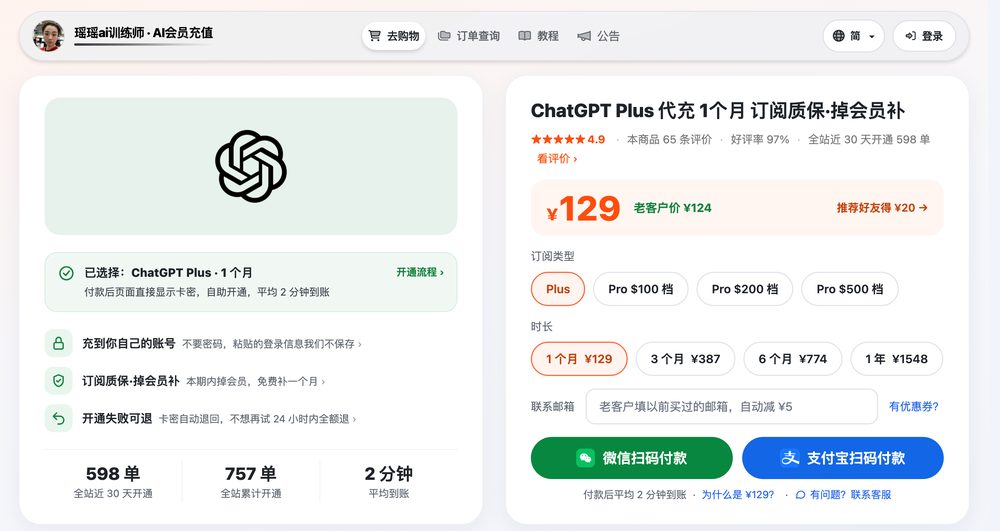
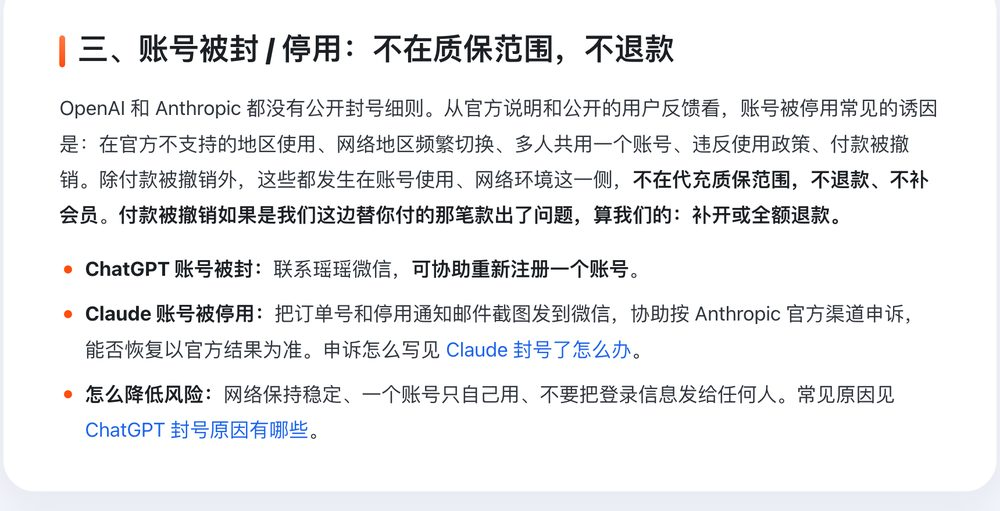

# ChatGPT封号 2026：为什么被封、能不能解、会员钱怎么办

> 2026-11-20 更新

**先说结论：** ChatGPT封号，官方叫账号停用或关闭，常见起因是违反使用政策、违反条款（比如共享账号）、安全原因和没按时完成验证。能申诉，用停用邮件里的链接或官方申诉表，但官方写明不保证恢复。瑶瑶ai训练师照实说店规：封号不在质保、不退款，ChatGPT 封号可以协助你重新注册一个号；换了新号，在瑶瑶店里重开 [ChatGPT Plus 一个月 ¥129](https://kw.yaoyao.chat/item/5?utm_source=github&utm_medium=readme&utm_campaign=gptfenghao&utm_content=top)，支付宝、微信付，平均 2 分钟到账。下单填券码 **888888** 再减 ¥3。

- **先分清**：请求太多、地区不支持、额度用完都不是封号；真被停用，一般会收到 OpenAI 的邮件。
- **能不能解**：按邮件里的申诉链接提交，附上用户 ID 和情况说明；等 30 天不会自动解封。
- **会员钱怎么办**：官方订阅按条款一般不退，7 天内没怎么用过的可以申请酌情退款；代充开的会员，店里也不退。
- **谁不用买**：号还在申诉、可能救回来的，先别急着开新会员；只是撞了额度或网络问题的，根本不是封号。

*图：换了新号要重开会员时的下单页，Plus 一个月 ¥129（瑶瑶商城 kw.yaoyao.chat/item/5，11 月 10 日截图）*

## 先确认：你是被封了，还是别的问题

很多人以为自己 ChatGPT封号，其实是别的情况。对照一下：

| 你看到的 | 实际情况 | 怎么办 |
|---|---|---|
| 请求太多、稍后再试 | 短时间请求过多，临时限制 | 等一会儿再用 |
| 所在国家或地区不支持 | 当前网络地区不在支持名单 | 检查网络环境，保持稳定 |
| 已达到使用上限 | 额度用完 | 等重置，或升级套餐 |
| 会员没了、账号还能登录 | 订阅失效或付款被撤销，不是封号 | 查订阅页；代充的找卖家 |
| 对话被结束、自己被登出 | 可能是临时安全暂停 | 暂停结束后能再登录 |
| 登录提示 deleted or deactivated | 账号被删除或被停用 | 先查邮箱，按邮件处理 |

帮助中心《Troubleshooting "deleted or deactivated" account errors》写得很清楚：看到"You do not have an account because it has been deleted or deactivated"，要么是你自己删了号，要么是被官方停用了，先去邮箱（包括垃圾箱）找 OpenAI 的邮件。

"会员没了、号还在"这种，在代充用户里最常见，它属于掉会员，不是封号。瑶瑶店里本期内掉会员，凭订单号和截图再补一个月；掉会员和封号在店规里怎么区分，见 [掉会员、开通失败、封号的售后规则](https://kw.yaoyao.chat/guide/shouhou-zhibao.html?utm_source=github&utm_medium=readme&utm_campaign=gptfenghao&utm_content=guide)。

## ChatGPT 为什么被封：官方列的四类原因

帮助中心《OpenAI account closures and safety suspensions》（2026-11-10 核对）把停用原因分成几类：

**1. 违反使用政策。** 官方列了这些：违规的色情内容、涉及儿童的剥削、助长暴力、鼓励自残、诈骗、仇恨骚扰和垃圾信息、违法活动、侵犯知识产权。官方也补了一句：聊到敏感话题本身不等于会被永久关闭，要看具体情况。

**2. 违反使用条款。** 例子有三个：绕过安全控制或访问限制；以违反条款的方式共享账号或 API Key；用 OpenAI 的服务伤害他人或干扰服务。

**3. 安全原因。** 系统发现像是别人登录了你的号，会限制访问。被盗号后别人拿去乱用，你的号一样会出事。

**4. 屡次警告不改、验证没按时做完。** 有些违规会先发警告，给你时间改；没改或者超时，可能永久关闭。需要年龄或身份验证的账号，没按时完成也可能被停用。

另外还有一种**临时安全暂停**：对话因为暴力伤害方面的严重问题多次被结束后，ChatGPT 可能暂时停掉你的号，期间登不上，暂停结束就能再登。它和永久关闭是两回事。

官方没写的那部分，也说一下。OpenAI 没有公开具体风控规则，但从国内用户常见的情况看，频繁切换网络地区、多人共用一个号、短时间批量注册新号，都容易被系统当成异常。这几条在条款里分别对应"绕过访问限制"和"共享账号"。各种原因放在一起的清单，kw 那篇 [ChatGPT 封号原因有哪些](https://kw.yaoyao.chat/guide/chatgpt-fenghao.html?utm_source=github&utm_medium=readme&utm_campaign=gptfenghao&utm_content=guide) 也有。

## 能不能解封：申诉怎么提

官方给的申诉路径只有这几条（2026-11-10 核对）：

1. **收到了关闭通知邮件**：用邮件里的申诉链接提交。
2. **邮件找不到了**：通过帮助中心的账号关闭申诉表提交。
3. **登不上号，但从没收到关闭邮件**：在帮助中心联系 OpenAI Support。

申诉时可以写上：用户 ID 和组织 ID（有的话）、你平时怎么用、为什么认为是误判；如果怀疑被盗号，写上可疑登录的时间段和你已经做的补救，比如改了密码。看到不认识的扣款，还要附上扣款日期、金额、卡号后四位、卡组织、发卡行和账单邮编；完整卡号和安全码不要发。

有几件事要心里有数：

- 官方写明**申诉不保证恢复**。
- **等 30 天不会自动解封**。"30 天后能用同一个邮箱重新注册"只适用于你自己删除的号，被停用的号不适用。
- 申诉期间别换着渠道反复提交，也别马上注册一堆新号。

申诉用英文写就行，简单直接：账号邮箱、你的用途、请求复核。比如：

> Hello, my ChatGPT account (你的邮箱) was deactivated. I mainly use it for work and study and believe this may be a mistake. Could you please review it? Thank you.

还要提防假的封号通知。有人冒充 OpenAI 发邮件或短信，说账号异常、要你点链接登录或者交"解封费"。官方不会收钱解封，也不会加你微信 QQ 处理；拿不准就自己打开 chatgpt.com 登录看看。

## 封号后订阅还扣不扣钱、怎么申请官方退款

这是封号后最容易被忽略、也最容易吃亏的一环。分你怎么付的钱来说。

**你自己在官网绑卡订阅的。**
帮助中心没有写"停用后自动停止扣费"，别赌它会自己停。能登录就到设置 → Billing → Cancel plan 取消；登不上，按《Canceling your ChatGPT subscription》里"登不上号怎么取消"的办法，联系 OpenAI Support，提供账号或账单邮箱，再加下面任意两项：卡号后四位、卡的有效期、账单地址、最近一次扣款日期。官方提醒，取消只是停止续费，不会自动退已经扣的钱。

**要退款，按官方规则走。**
帮助中心《How do I request a refund for my ChatGPT subscription?》写的是：

- 付款原则上不退，但官方核实的账单错误、确认的盗刷、有记录的服务故障可以退；
- 个人订阅**扣款 7 天内、这一期没怎么用过**的，可以申请酌情退款，前提包括没有重复退款记录、没有正在进行的拒付、没有确认的滥用；
- 7 天后不按天折算退款；
- 欧盟、英国、土耳其居民，购买 14 天内取消可以按比例退；韩国、巴西另有规定；
- 网页订阅的在帮助中心右下角聊天窗口里申请，要登录被扣钱的那个账号，批准后 5～7 个工作日处理；Google Play 订阅的约 10 个工作日。

因为违反政策被关的号，"确认的滥用"这一条就可能卡住退款，能不能退以官方回复为准。

**在 iPhone 或安卓商店订的。**
订阅归商店管。苹果：设置 → 你的名字 → 订阅 → ChatGPT → 取消订阅；退款向苹果申请。Google Play：商店 App 的订阅里取消。官方特别提醒，删掉 ChatGPT 账号不会取消苹果那边的订阅。

**别直接找银行拒付。** 有拒付在进行时，官方不会另外退款；拒付本身还可能让账号被标记。先走官方或商店的流程。

**代充开的会员。** 付款人不是你，官方查不到你的付款记录，官方退款流程对你用不上；代充本身也不绑你的卡，到期不会再扣你的钱。售后找卖家。退款渠道的完整说明见 [ChatGPT 订阅能退款吗](https://kw.yaoyao.chat/guide/chatgpt-tuikuan.html?utm_source=github&utm_medium=readme&utm_campaign=gptfenghao&utm_content=guide)，取消续费的截图步骤见 [自动续费怎么取消](https://kw.yaoyao.chat/guide/cancel-renew.html?utm_source=github&utm_medium=readme&utm_campaign=gptfenghao&utm_content=guide)。

## 在瑶瑶店里开的会员，号被封了怎么办

店规照原样写：

- **账号被封或被停用，不在质保范围，不退款、不补会员。** 停用的诱因大多在使用这一侧，比如网络地区、共用、违规内容。
- **ChatGPT 封号，可以协助重新注册一个账号。** 把订单号和停用邮件截图发到瑶瑶企业微信。
- **有一个例外：** 如果是店里替你付的那笔款被撤销，导致掉会员或停用，算店里的，补开或全额退款。

*图：瑶瑶卡网售后与质保规则第三条（kw.yaoyao.chat/guide/shouhou-zhibao.html，2026-11-10 截图）*

瑶瑶店里卖的是代充，不承诺防封，也没有人能承诺。能做的是把风险降下来：

1. 一个号只给自己用，不合租、不借人；
2. 网络地区尽量固定，别一会儿美国一会儿日本；
3. 开两步验证，别在陌生网站输 ChatGPT 密码；
4. 开通会员粘贴过登录信息的，开通后到设置的安全里退出所有设备，旧的登录信息就作废了；
5. 重要对话定期在设置 → 数据管理里导出，号没了资料还在。

怎么判断代充卖家靠不靠谱、会不会因为付款渠道连累你的号，kw 有一篇 [GPT代充有风险吗、会封号吗](https://kw.yaoyao.chat/guide/daichong-fengxian.html?utm_source=github&utm_medium=readme&utm_campaign=gptfenghao&utm_content=guide)。

## 换新号重开会员：步骤和要避开的坑

申诉没结果，决定换号的：

1. **用新邮箱注册。** 被停用的号，原邮箱不会因为过了 30 天就能再注册；用一个没注册过 ChatGPT 的邮箱。国内注册要准备什么，见 [国内怎么注册 ChatGPT 账号](https://kw.yaoyao.chat/guide/zhuce-zhanghao.html?utm_source=github&utm_medium=readme&utm_campaign=gptfenghao&utm_content=guide)。
2. **先把老习惯改掉。** 旧号是因为什么被停的，新号就别再那样用，否则一样会出事。别一口气注册好几个。
3. **再开会员。** 在瑶瑶店里下 Plus，付款后拿卡密，到 cz.yaoyao.chat 复制新号的登录信息提交，平均 2 分钟到账。一定确认浏览器里登的是新号，提交前页面会识别邮箱，不对就退出重登。
4. **旧号里没到期的会员，转不到新号上。** 官方订阅绑在原账号上，代充开的也一样。

提交时最常见的失败是登录信息过期，开无痕窗口重新登录、复制完马上交。没开成卡密自动退回，可以重提；不想再试，订单号发企业微信，24 小时内全额退回。新号从注册好到出现 Plus 的全过程，见 [ChatGPT Plus 开通全流程](https://kw.yaoyao.chat/guide/chatgpt-plus-kaitong.html?utm_source=github&utm_medium=readme&utm_campaign=gptfenghao&utm_content=guide)。

确定新号会长期用的，也可以下 [ChatGPT Plus 3 个月 ¥387](https://kw.yaoyao.chat/item/5?d=3&utm_source=github&utm_medium=readme&utm_campaign=gptfenghao&utm_content=mid)，一单三张卡密，一张一个月，到期再充下一张。Plus 到底包含什么，文末相关教程第一篇有清单。

## 常见问题

**问：ChatGPT封号了还能恢复吗？**
能申诉，用停用邮件里的链接或官方申诉表，[帮助中心](https://help.openai.com/articles/10562188)写明不保证恢复。

**问：chatgpt封号会退钱吗？**
官方付款原则上不退，扣款 7 天内、没怎么用、没有滥用的可以申请酌情退款；欧盟、英国、土耳其有 14 天按比例退。代充开的会员，瑶瑶店里封号不退款。

**问：封号后会员能转到新号上吗？**
不能。官方订阅绑在原账号上；在瑶瑶店里买的，店里可协助重新注册一个号，会员要重新开。

**问：被封的号，过 30 天能用原邮箱重新注册吗？**
不能。30 天后可重用邮箱只针对你自己删除的号；被停用的号，等 30 天也不会恢复。

**问：ChatGPT 会封中国用户吗？**
中国大陆不在 OpenAI 的支持地区名单里。官方没公开风控细节，频繁换地区、多人共用这类用法风险更大。

**问：代充会不会导致封号？**
开在你自己账号上的代充，本身不碰你的密码和使用习惯。真正有风险的是低价渠道付款被撤销；瑶瑶店里如果是这种情况，补开或全额退款。挑卖家的方法见 [怎么判断一个 AI 会员代充靠不靠谱](https://kw.yaoyao.chat/guide/heshi-maijia.html?utm_source=github&utm_medium=readme&utm_campaign=gptfenghao&utm_content=guide)。

**问：封号后聊天记录还能找回吗？**
停用期间登不上，能不能拿回看申诉结果。平时定期导出数据，是唯一靠得住的备份。

新号准备好了，就到瑶瑶店里下 [ChatGPT Plus 一个月 ¥129（新号重开也能充）](https://kw.yaoyao.chat/item/5?utm_source=github&utm_medium=readme&utm_campaign=gptfenghao&utm_content=end)，结账填 **888888** 减 ¥3；推荐码或老客户减 ¥5 只能选一个和它分开用。

## 相关教程

- [ChatGPT Plus购买指南](https://github.com/yaoyao-chat/plus)：新号重开会员前，弄清 Plus 和免费版的差别
- [ChatGPT共享账号](https://github.com/yaoyao-chat/gongxiang)：合租靠谱吗、会不会封
- [ChatGPT Plus 国内充值指南](https://github.com/haiwaihuyonghui-rgb/gpt-chongzhi)：国内几种开 Plus 的路子各自要什么

原文地址：[github.com/yaoyao-chat/gptfenghao](https://github.com/yaoyao-chat/gptfenghao)（CC BY-ND 4.0，转载请保留原文地址、不得改编）

## 核对与来源

店规（封号不在质保、不退款，ChatGPT 封号协助重新注册，付款被撤销算店里的）、价格、退款时限以商城事实卡 11 月 10 日凌晨那一版为准。官方部分都是 2026-11-10 当天打开核对。

- 帮助中心 [OpenAI account closures and safety suspensions](https://help.openai.com/en/articles/10562188-openai-account-closures-and-safety-suspensions)：停用原因四类、临时安全暂停、申诉渠道、申诉要附的信息、不保证恢复、降低风险的做法
- 帮助中心 [Troubleshooting "deleted or deactivated" account errors](https://help.openai.com/en/articles/8958977-troubleshooting-deleted-or-deactivated-account-errors)：报错含义、先查邮箱
- 帮助中心 [Creating a new ChatGPT account after deletion](https://help.openai.com/en/articles/9019931-creating-a-new-chatgpt-account-after-deletion)：30 天后重用邮箱只针对已删除的号；等 30 天不会恢复被停用的号
- 帮助中心 [How do I request a refund for my ChatGPT subscription?](https://help.openai.com/en/articles/7232895-how-do-i-request-a-refund-for-my-chatgpt-subscription)：原则不退、7 天酌情退款条件、欧盟英国土耳其 14 天、网页 5～7 个工作日、Google Play 10 个工作日、拒付期间不另退
- 帮助中心 [Canceling your ChatGPT subscription](https://help.openai.com/en/articles/7232927-canceling-your-chatgpt-subscription)：网页、苹果、Google Play 取消步骤；登不上号时联系客服要的信息；取消不等于退款
- [OpenAI 使用条款（中文）](https://openai.com/zh-Hans-CN/policies/row-terms-of-use/)：违反条款或使用政策可暂停或终止；认为误判可联系支持团队申诉；已付费用除法律规定外不退
- [OpenAI 支持的国家和地区](https://developers.openai.com/api/docs/supported-countries)：名单里没有中国大陆
- 假封号通知、申诉信写法、数据导出入口：参考 kw 教程页 chatgpt-fenghao（2026-10-28 更新）

## 关于作者与声明

文章由瑶瑶ai训练师整理。她 2023 年 10 月入行做 AI 科普，2026 年 3 月开了 kw.yaoyao.chat，文里的商城链接是给自家店打的广告。这里说的代充不是官方渠道，店铺跟 OpenAI 没有隶属，也没有拿到授权。密码和验证码只留在你自己手里，自称瑶瑶客服来要的也别给；客服只在企业微信 `kw.yaoyao.chat/wecom`。
